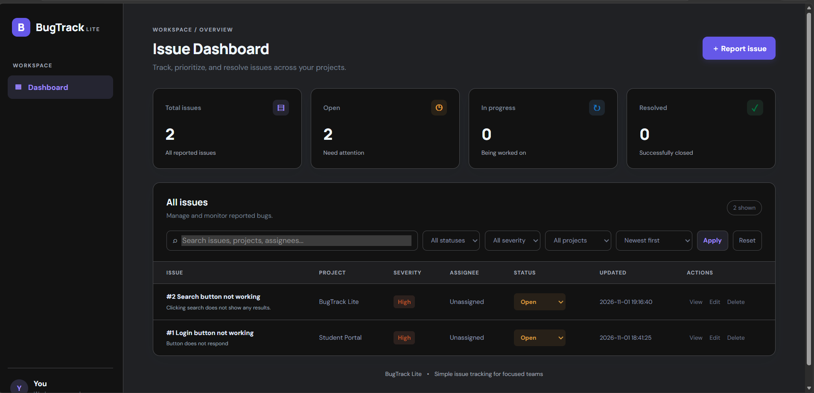

# 🐛 BugTrack Lite

### Software Bug Tracking and Issue Management System

BugTrack Lite is a lightweight web-based bug tracking application designed to help developers and teams report, organize, track, and resolve software issues efficiently.

The application provides a centralized dashboard for managing bugs, monitoring their status, assigning issues, and maintaining a history of issue-related activities.

---

## 📸 Project Preview



---

## ✨ Features

### 📊 Dashboard
- View total reported issues.
- Monitor open, in-progress, and resolved issues.
- Get a quick overview of the project's issue status.

### 🐞 Issue Management
- Create new issues with title, description, project, and severity.
- View complete issue details.
- Edit existing issues.
- Delete issues.
- Assign issues to team members.

### 🔄 Status Tracking
- Update issue status directly from the dashboard.
- Track issues through:
  - Open
  - In Progress
  - Resolved

### 🔍 Search, Filter, and Sort
- Search issues by title, description, project, or assignee.
- Filter issues by status.
- Filter issues by severity.
- Filter issues by project.
- Sort issues by creation date, update date, title, or severity.

### 💬 Comments and Activity History
- Add comments to issues.
- View previous comments.
- Track issue-related activities.
- Maintain a record of status changes and issue updates.

### 🎨 User Interface
- Modern dark-themed dashboard.
- Responsive layout.
- Clean and intuitive interface.

---

## 🛠️ Technology Stack

| Technology | Purpose |
|---|---|
| Python | Backend programming |
| Flask | Web application framework |
| SQLite | Database management |
| HTML5 | Web page structure |
| CSS3 | Styling and responsive layout |
| JavaScript | Frontend interactions |
| REST API | Communication between frontend and backend |
| Git & GitHub | Version control and project hosting |

---

## 📁 Project Structure

```text
BugTrack-Lite/
│
├── app.py
├── requirements.txt
├── .gitignore
│
├── database/
│   └── db.py
│
├── templates/
│   └── dashboard.html
│
└── static/
    ├── css/
    │   └── style.css
    │
    └── js/
        └── dashboard.js
```

---

## ⚙️ Installation and Setup

Follow these steps to run BugTrack Lite locally.

### 1. Clone the repository

```bash
git clone https://github.com/iit2025215-glitch/BugTrack-Lite.git
```

### 2. Navigate to the project directory

```bash
cd BugTrack-Lite
```

### 3. Create a virtual environment

```bash
python -m venv .venv
```

### 4. Activate the virtual environment

**Windows PowerShell:**

```powershell
.\.venv\Scripts\Activate.ps1
```

**Linux / macOS:**

```bash
source .venv/bin/activate
```

### 5. Install dependencies

```bash
pip install -r requirements.txt
```

### 6. Run the application

```bash
python app.py
```

### 7. Open the application

Visit the following URL in your browser:

```text
http://127.0.0.1:5000
```

The application will initialize its SQLite database automatically.

---

## 🗄️ Database

BugTrack Lite uses SQLite for persistent data storage.

The database manages:

- Bug and issue records
- Issue severity and status
- Project information
- Assignee information
- Comments
- Activity history

The database schema is initialized automatically when the application starts.

---

## 🚀 Future Enhancements

Potential improvements for future versions include:

- User authentication and authorization
- Role-based access control
- Email notifications
- File and screenshot attachments
- Advanced analytics and reporting
- Deployment to a cloud platform
- Team collaboration features

---

## 👨‍💻 Authors

- **Shreyansh Raj Singh**
- **Avaneesh Verma**
- **Roshan**

GitHub: [@iit2025215-glitch](https://github.com/iit2025215-glitch)

---

## 📄 License

This project is developed for educational purposes as part of a Software Engineering project.

